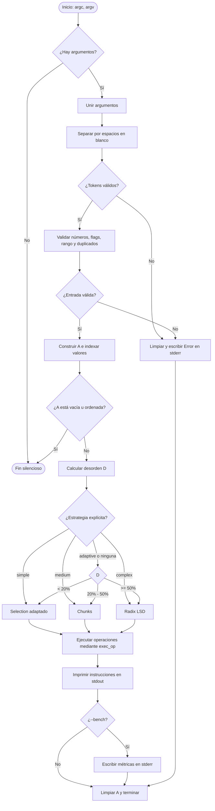
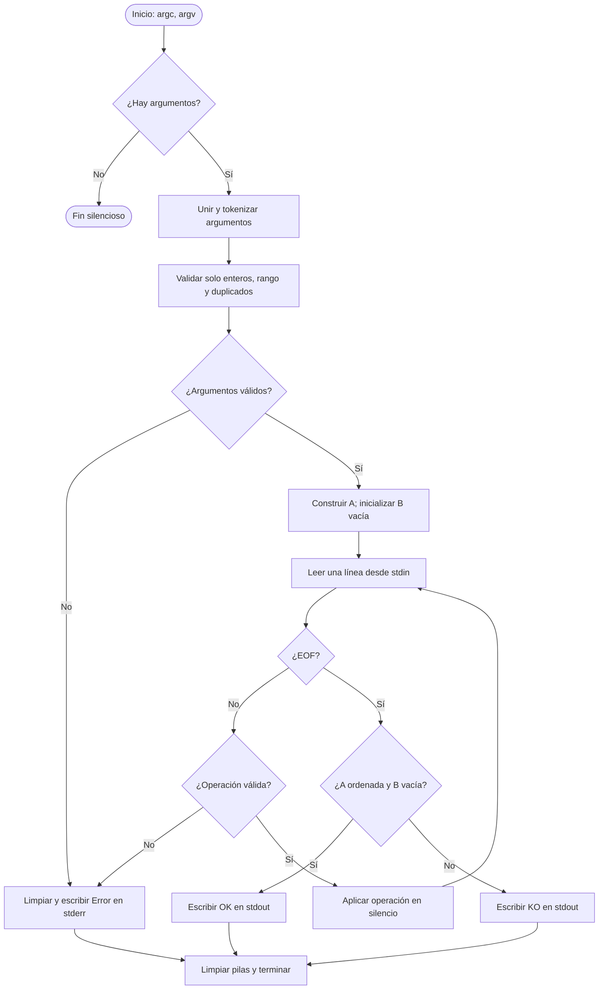

*This project has been created as part of the 42 curriculum by frgonzal, fradiaz.*

# push_swap

Implementación de **push_swap** para 42 Málaga. El proyecto ordena una
secuencia de enteros utilizando dos pilas (`A` y `B`) y únicamente las
operaciones permitidas por el subject. Incluye el bonus `checker`, que
reproduce una secuencia de instrucciones y comprueba el resultado.

## Índice

- [Description](#description)
- [Instructions](#instructions)
- [Compilación](#compilación)
- [Uso de `push_swap`](#uso-de-push_swap)
- [Estrategias de ordenación](#estrategias-de-ordenación)
- [Justificación de los algoritmos](#justificación-de-los-algoritmos)
- [Operaciones](#operaciones)
- [Bonus: `checker`](#bonus-checker)
- [Arquitectura](#arquitectura)
- [Flujo de ejecución de `push_swap`](#flujo-de-ejecución-de-push_swap)
- [Flujo de ejecución de `checker`](#flujo-de-ejecución-de-checker)
- [Validación y casos límite](#validación-y-casos-límite)
- [Resources](#resources)
- [Estructura del proyecto](#estructura-del-proyecto)

## Description

`push_swap` recibe enteros, construye la pila `A` y escribe en `stdout` una
secuencia de operaciones que deja `A` ordenada de menor a mayor y `B` vacía.
El programa:

1. Une todos los argumentos y los separa por espacios en blanco, por lo que
   acepta tanto argumentos individuales como una cadena entre comillas.
2. Valida el formato de cada token, las banderas, el rango de `int` y los
   duplicados.
3. Convierte los valores a índices relativos consecutivos (`0 ... n - 1`).
4. Calcula el índice de desorden inicial.
5. Resuelve los casos pequeños o selecciona una estrategia de ordenación.
6. Libera la memoria reservada antes de terminar.

Un error de entrada imprime `Error` en `stderr`. Sin argumentos, o con una
entrada válida sin números, el programa termina silenciosamente.

## Instructions

### Compilación e instalación

No se necesitan dependencias externas: la biblioteca [`Libft/`](./Libft/)
forma parte del repositorio. Desde la raíz del proyecto:

## Compilación

Requisitos:

- `cc`
- `make`
- Una plataforma compatible con la `libft` incluida en [`Libft/`](./Libft/)

Desde la raíz del repositorio:

```bash
make            # Compila push_swap
make bonus      # Compila checker
make clean      # Elimina objetos
make fclean     # Elimina objetos, binarios y objetos de Libft
make re         # Reconstruye push_swap desde cero
```

Los binarios generados son `./push_swap` y `./checker`.

### Ejecución

## Uso de `push_swap`

```bash
./push_swap 2 1 3
./push_swap "4 1 -2 3"
```

También se puede elegir explícitamente la estrategia o activar las métricas:

```bash
./push_swap --simple 4 1 3 2
./push_swap --medium 4 1 3 2
./push_swap --complex 4 1 3 2
./push_swap --adaptive 4 1 3 2
./push_swap --bench --adaptive 4 1 3 2
```

Las banderas de estrategia son mutuamente excluyentes. `--adaptive` es la
estrategia utilizada por defecto cuando no se indica otra. `--bench` no mezcla
las métricas con la solución: las instrucciones siguen saliendo por
`stdout` y el resumen se escribe en `stderr`.

Una comprobación habitual combina ambos programas:

```bash
./push_swap 4 1 3 2 | ./checker 4 1 3 2
# OK
```

## Estrategias de ordenación

Antes de ordenar, cada valor se normaliza a su posición relativa. Esto permite
comparar índices pequeños y hace posible aplicar Radix sin depender de los
valores originales.

| Opción | Implementación | Complejidad aproximada | Uso |
| --- | --- | --- | --- |
| `--simple` | Selection adaptado: lleva repetidamente el mínimo a `B` y lo devuelve a `A` | `O(n²)` | Entradas pequeñas o poco desordenadas |
| `--medium` | Chunks de tamaño aproximado `sqrt(n)`, con rotaciones de `B` | `O(n√n)` | Desorden intermedio |
| `--complex` | Radix LSD por bits sobre los índices normalizados | `O(n log n)` | Desorden alto |
| `--adaptive` | Selector según el desorden inicial | Depende del tramo | Opción por defecto |

El índice se guarda internamente como `disorder * 10000`, evitando trabajar
con `float` en la selección:

- `D < 0,20` (`disorder < 2000`): Selection adaptado.
- `0,20 <= D < 0,50` (`2000 <= disorder < 5000`): Chunks.
- `D >= 0,50` (`disorder >= 5000`): Radix LSD.

El modo `--bench` muestra el porcentaje de desorden, la estrategia elegida,
el total de operaciones y el desglose por instrucción.

## Justificación de los algoritmos

La elección de estrategias responde a dos restricciones del problema: solo se
pueden transformar las pilas mediante las operaciones permitidas y el número
de movimientos es un criterio importante de calidad. Por eso no se ordenan
directamente arrays ni se utiliza una ordenación genérica; cada algoritmo se
ha adaptado a las pilas `A` y `B`.

### Normalización por índices

Los valores pueden ser negativos y abarcar todo el rango de `int`, mientras
que Radix necesita trabajar con claves acotadas y no negativas. Después de
validar los valores, se asigna a cada nodo su posición en el orden final:
`0` para el mínimo y `n - 1` para el máximo. Esta transformación conserva
todas las comparaciones relevantes, evita overflow durante las estrategias y
hace que los algoritmos dependan de `n`, no de la magnitud de los enteros.

### Selection adaptado

### Selection sort (`--simple`)

Para el caso simple se busca el mínimo restante, se decide si conviene
acercarlo con `ra` o `rra`, y se mueve a `B` con `pb`. Cuando `A` queda
ordenada, los elementos se recuperan mediante `pa`. Es una estrategia
determinista y sencilla de verificar, adecuada para tamaños pequeños, pero
su búsqueda repetida del mínimo cuesta `O(n²)` y por eso no se fuerza para
entradas grandes.

### Chunks (`--medium`)

Chunks divide el intervalo de índices en ventanas de tamaño aproximado
`sqrt(n)`. En cada paso, los elementos pertenecientes a la ventana activa se
envían a `B`; las rotaciones de `B` ayudan a mantener cerca de la cima los
elementos que se necesitarán antes. Después se reconstruye `A` buscando el
máximo de `B` y eligiendo `rb` o `rrb` según su posición. El coste esperado
es `O(n√n)`, un compromiso entre el número de movimientos y el coste de
búsqueda para tamaños intermedios.

### Radix LSD (`--complex`)

Radix procesa los índices bit a bit, desde el menos significativo. En cada
pasada, los nodos cuyo bit es `0` pasan a `B` mediante `pb`, mientras que los
que tienen `1` permanecen en `A` mediante `ra`; al final se recupera `B` con
`pa`. La estabilidad de cada pasada permite ordenar los índices al completar
todos los bits. Si `k = ceil(log2(n))`, el coste es `O(nk)`, aproximadamente
`O(n log n)`, sin comparaciones directas entre todos los pares.

### Selector adaptativo

`compute_disorder` cuenta las inversiones de la secuencia normalizada y divide
por el número total de pares. El resultado se escala por `10000` para
compararlo como entero. El selector usa los umbrales definidos por el
proyecto: Selection para `D < 0,20`, Chunks para `0,20 <= D < 0,50` y Radix
para `D >= 0,50`. Así, las entradas casi ordenadas no pagan el coste de una
estrategia general y las entradas muy desordenadas utilizan el algoritmo con
mejor crecimiento asintótico. Los tamaños de hasta cinco elementos se
resuelven antes con casos específicos, porque permiten secuencias más cortas
que las estrategias generales.

## Operaciones

Todas las operaciones modifican las pilas **in-place**. `push_swap` las
registra y las imprime; `checker` las ejecuta silenciosamente.

| Operación | Efecto |
| --- | --- |
| `sa` / `sb` | Intercambia los dos primeros elementos de `A` / `B` |
| `ss` | Ejecuta `sa` y `sb` |
| `pa` / `pb` | Mueve el primero de `B` a `A` / de `A` a `B` |
| `ra` / `rb` | Desplaza el primer elemento al final de `A` / `B` |
| `rr` | Ejecuta `ra` y `rb` |
| `rra` / `rrb` | Desplaza el último elemento al principio de `A` / `B` |
| `rrr` | Ejecuta `rra` y `rrb` |

## Bonus: `checker`

`checker` recibe los mismos enteros que `push_swap` y lee instrucciones desde
`stdin`, una por línea, hasta `EOF`:

```bash
printf 'sa\n' | ./checker 2 1
```

Al terminar:

- imprime `OK` en `stdout` si `A` está ordenada y `B` está vacía;
- imprime `KO` en `stdout` si no se cumple alguna de esas condiciones;
- imprime `Error` en `stderr` si los argumentos son inválidos o aparece una
  instrucción desconocida o mal formada.

El bonus admite las instrucciones estándar (`sa`, `sb`, `ss`, `pa`, `pb`,
`ra`, `rb`, `rr`, `rra`, `rrb`, `rrr`) y no admite banderas de estrategia ni
`--bench`.

La salida de `push_swap` puede validarse directamente:

```bash
ARG="4 1 3 2"
./push_swap $ARG | ./checker $ARG
```

## Arquitectura

El código separa la preparación de datos, el motor de ordenación, las
operaciones físicas y la telemetría:

- **Entrada y validación:** `join_args.c`, `ft_split_set.c`,
  `validate_input.c` y `extract_numbers.c`.
- **Pilas y memoria:** `utils_structs.c`, `stack_aux.c`, `clean_leaks.c` y
  `stack_operations.c`.
- **Orquestación:** `orchestating_operator.c`, `init_to_order.c` y
  `main.c`.
- **Estrategias:** `strategy_implement.c`, `chunks_sort.c` y `ft_complex.c`.
- **Telemetría:** `operations_bridge.c`, `dispatcher.c` y
  `dispatcher_aux.c`.
- **Bonus:** `checker_bonus.c`, `checker_bonus.h`, `operations_bonus.c` y
  `orquestating_bonus.c`.
- **Dependencias:** `Libft/`.

La capa de operaciones primitivas solo modifica punteros. La capa puente de
`push_swap` aplica la operación, cuenta el movimiento y lo imprime; el
`checker` reutiliza las primitivas sin imprimir ni contabilizar operaciones.

## Flujo de ejecución de `push_swap`



El motor mantiene `B` como `NULL` al inicio y la vacía al finalizar. Para
tamaños de hasta cinco elementos utiliza rutinas específicas antes de aplicar
una estrategia general.

## Flujo de ejecución de `checker`



## Validación y casos límite

Se controlan los casos relevantes del subject:

- entrada sin argumentos;
- argumentos individuales o agrupados en una cadena;
- signos `+` y `-`;
- valores `INT_MIN` y `INT_MAX`;
- overflow y tokens no numéricos;
- duplicados;
- valores negativos;
- uno, dos, tres y cinco elementos;
- entrada ya ordenada o en orden inverso;
- instrucciones inválidas en `checker`;
- limpieza de las pilas y de las matrices de tokens ante errores.

## Estructura del proyecto

```text
.
├── Makefile
├── push_swap.h
├── checker_bonus.h
├── *.c                 # Motor, validación, operaciones y estrategias
└── Libft/
    ├── Makefile
    ├── libft.h
    └── *.c
```

## Resources

Referencias consultadas para el diseño y la implementación:

- **Subject de `push_swap`**, requisitos oficiales del proyecto y del bonus
  `checker` proporcionados por 42.
- [cppreference: `std::sort` y complejidad algorítmica](https://en.cppreference.com/w/cpp/algorithm/sort),
  como referencia general para comparar costes de ordenación.
- [Wikipedia: Radix sort](https://en.wikipedia.org/wiki/Radix_sort), fundamentos
  del ordenamiento por dígitos y su variante LSD.
- [Wikipedia: Selection sort](https://en.wikipedia.org/wiki/Selection_sort),
  propiedades y complejidad de la estrategia simple.
- [Wikipedia: Insertion sort](https://en.wikipedia.org/wiki/Insertion_sort),
  referencia conceptual para razonar sobre secuencias parcialmente ordenadas.

### Uso de inteligencia artificial

Se utilizó IA como herramienta de apoyo, no como sustituto de la comprensión,
las decisiones técnicas ni la validación del código. En concreto, se empleó
para:

- analizar el repositorio y contrastar el README con el código existente;
- organizar y redactar la documentación de instalación, uso, arquitectura y
  los diagramas Mermaid;
- revisar la explicación de normalización, desorden, Selection, Chunks,
  Radix LSD y el bonus `checker`;
- proponer ejemplos de comandos y comprobaciones de humo.

La implementación, integración y validación final se realizaron sobre el
repositorio local por los autores. Las decisiones sobre las estrategias, los
umbrales adaptativos, las operaciones de las pilas y el comportamiento de
errores se contrastaron con el código fuente y el subject antes de
documentarse.
