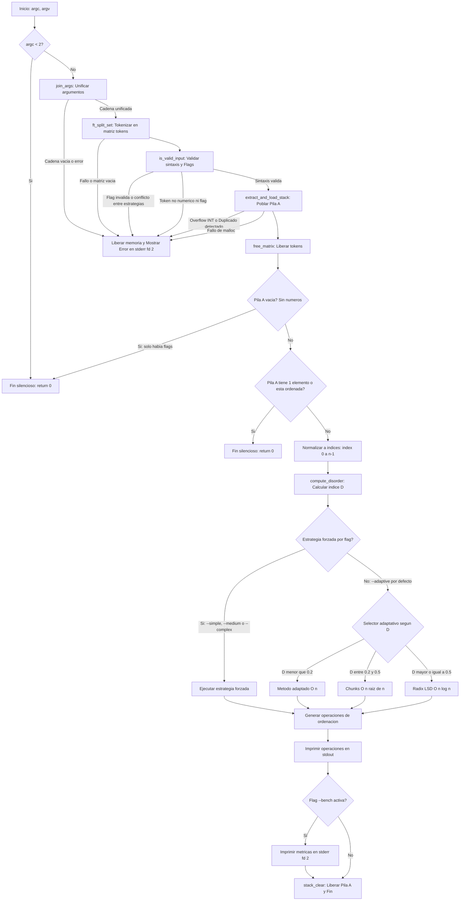
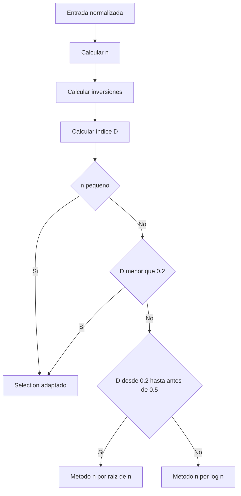
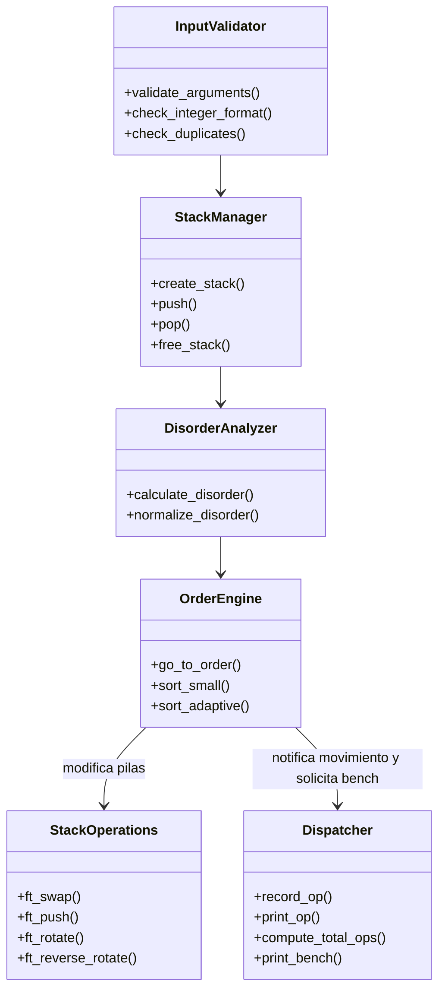
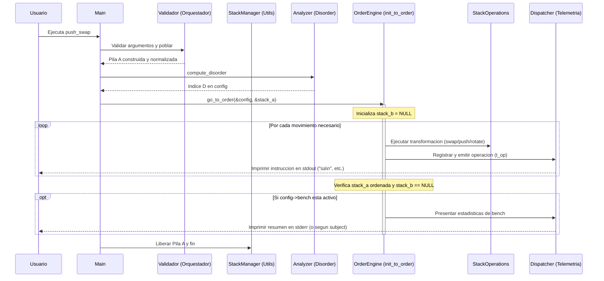
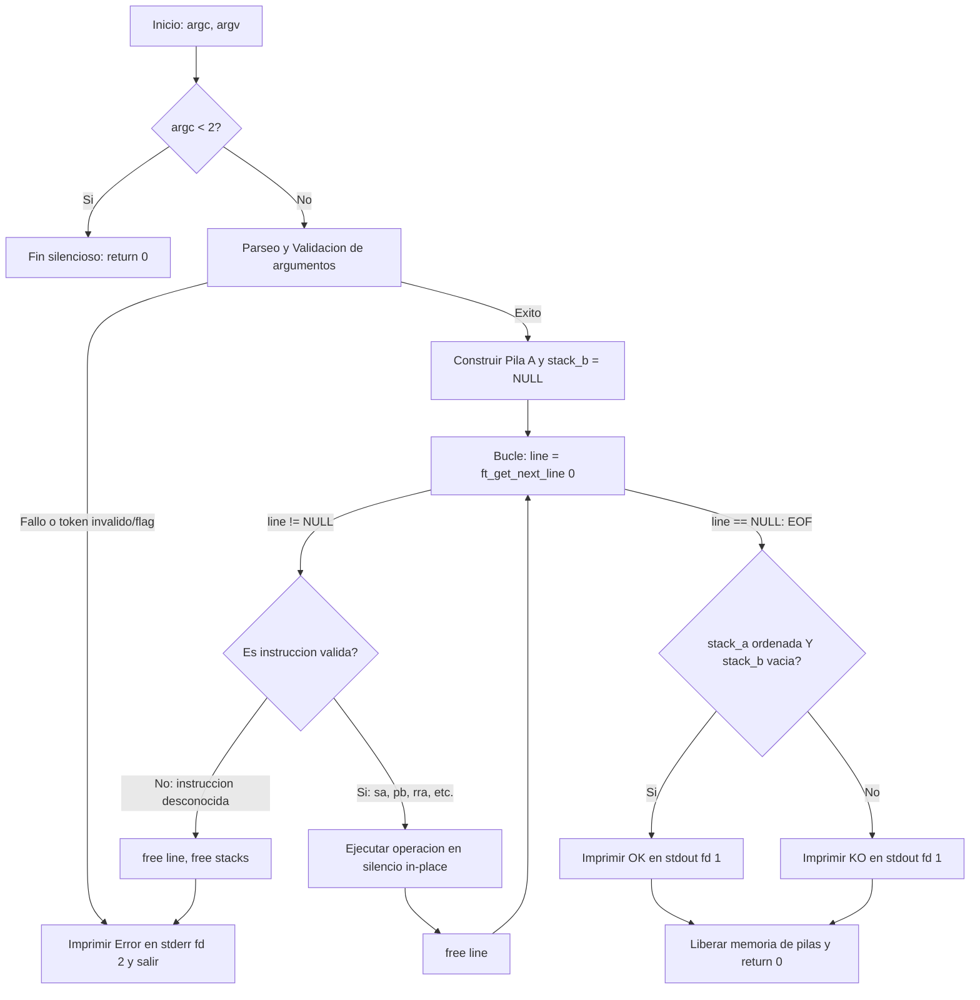
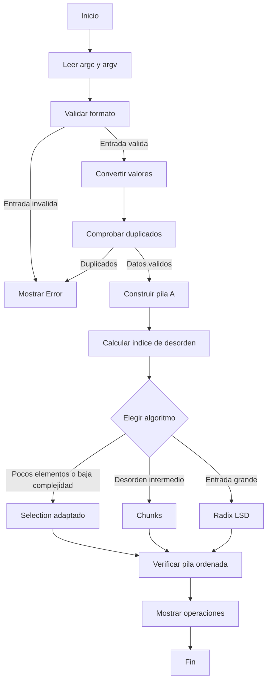

# Diagramacion de push_swap
Este documento recoge la arquitectura inicial y el flujo de decision del
proyecto. Su objetivo es que el grupo tenga una referencia comun antes de
implementar los algoritmos.
## Objetivo general

El programa debe:
1. Leer y validar los argumentos de entrada.
2. Convertir los valores a una representacion util para ordenar.
3. Construir la pila A.
4. Medir el desorden de la entrada.
5. Elegir una estrategia de ordenacion.
6. Generar solo operaciones validas de `push_swap`.
7. Dejar la pila A ordenada y la pila B vacia.
Las estrategias previstas son:

- Selection adaptado: algoritmo sencillo, con complejidad teorica `O(n^2)`.
- Chunks: divide la entrada en aproximadamente `sqrt(n)` chunks.
- Radix LSD: procesa los bits menos significativos, con complejidad habitual
    `O(n * k)`, donde `k` es el numero de bits procesados.
- Selector adaptativo: decide que estrategia utilizar segun el tamano y el
    indice de desorden.
## Conclusiones de diseno

### Flujo comun y Orquestacion
La aplicacion utiliza una funcion orquestadora (`orchestrating_function`) que
gestiona el ciclo de vida completo de la entrada, la validacion y la reserva
de memoria.

Se adopta una convencion estricta de codigos de retorno tipo UNIX en todas las
funciones de validacion y parseo:
- `0`: Exito total. La ejecucion continua.
- `-1`: Error fatal. Se detiene el flujo inmediatamente, se libera toda la
  memoria dinamica reservada hasta ese punto y se emite `"Error\n"` en `stderr` (fd 2).

El flujo de procesamiento previo al algoritmo se divide en fases ordenadas:
1. **Normalizacion textual:** `join_args` unifica todos los argumentos de la
   linea de comandos intercalando espacios y detectando cadenas vacias (`""`)
   o cadenas compuestas exclusivamente por espacios en blanco.
2. **Tokenizacion:** `ft_split_set` descompone la cadena unificada en una matriz
   de tokens (`char **tokens`), eliminando cualquier delimitador de espacio en blanco.
   La cadena unificada se libera inmediatamente tras el split.
3. **Clasificacion de tokens y validacion sintactica (`is_valid_input`):**
   - **Banderas (flags):** Se identifican los selectores de estrategia (`--simple`,
     `--medium`, `--complex`, `--adaptive`) y el modo de metricas (`--bench`).
     Se validan con `validate_flags` y se registran en una estructura de configuracion
     `t_config` basada en el enum `t_strategy`. Se rechazan banderas desconocidas o
     conflictos entre estrategias (retornando `-1`).
   - **Numeros:** Se verifica su formato sintactico con `is_valid_number_format`
     (signo opcional seguido unicamente de digitos).
4. **Construccion de la Pila A e insercion validada (`extract_and_load_stack`):**
   En una sola pasada sobre los tokens validados:
   - Los tokens de tipo bandera se omiten.
   - Cada token numerico se convierte con `ft_atol_safe`, controlando desbordamientos
     respecto a `INT_MIN` e `INT_MAX`.
   - Se comprueba en tiempo de insercion que no exista duplicado en la lista (`has_duplicate`).
   - Se crea dinamicamente el nodo (`node_new`) inicializando `index = -1` y se enlaza
     al final de la lista con `stack_add_back`.
   - Si ocurre cualquier error durante este proceso, la funcion invoca `stack_clear`
     sobre la pila parcialmente construida y propaga el codigo de error `-1`.
5. **Gestion del ciclo de vida y casos limite:**
   - Si no se proporcionan argumentos (`argc < 2`), el programa retorna `0` en silencio.
   - Si la entrada es valida pero no contiene numeros (por ejemplo, unicamente flags),
     el programa termina con exito y en silencio (`return 0`).
   - En cualquier escenario de error (`-1`), la orquestadora garantiza la liberacion de
     la matriz de tokens (`free_matrix`), la limpieza de la pila (`stack_clear`) y la
     emision del mensaje `"Error\n"` en `stderr` (fd 2).
6. **Estructuras de datos del modulo:**
   ```c
   typedef enum e_op
   {
       OP_SA,
       OP_SB,
       OP_SS,
       OP_PA,
       OP_PB,
       OP_RA,
       OP_RB,
       OP_RR,
       OP_RRA,
       OP_RRB,
       OP_RRR,
       OP_COUNT
   }   t_op;

   typedef enum e_strategy
   {
       STRAT_NONE,
       STRAT_SIMPLE,
       STRAT_MEDIUM,
       STRAT_COMPLEX,
       STRAT_ADAPTIVE
   }   t_strategy;

   typedef struct s_config
   {
       t_strategy  strategy;
       int         bench;
       int         disorder;
       int         op_counts[OP_COUNT];
   }   t_config;

   typedef struct s_to_order
   {
       int                 value;
       int                 index;
       struct s_to_order   *next;
   }   t_to_order;
   ```
7. **Siguientes fases arquitectonicas:**
   - **Indexacion (normalizacion de valores):** Asignar a cada nodo en `stack_a->index`
     su posicion relativa de orden (`0` a `n - 1`).
   - **Calculo de desorden (`compute_disorder`):** Medir el ratio $D$ de pares desordenados.
   - **Motor de ordenacion (`init_to_order`):** Control del flujo algoritmico y ciclo de vida de `stack_b`.
   - **Capa de registro y telemetria (`dispatcher`):** Conteo de operaciones, emision de instrucciones y reporte de `--bench`.
   - **Selector de estrategia adaptativa:** Aplicar la flag configurada o decidir en base a $D$.
### Arquitectura del Subsistema de Ordenacion y Telemetria

Para evitar acoplamientos y dependencias circulares, el subsistema se articula mediante una capa puente con responsabilidades unidireccionales estrictas:

```
[init_to_order] (Motor de ordenacion)
       │
       ▼
[operations_bridge] (exec_op: despacha la operacion)
       │
       ├─► [stack_operations] (Modificacion fisica in-place de punteros)
       │
       └─► [dispatcher] (Registro, emision y metricas de benchmark)
```

1. **`stack_operations.c` (Primitivas de pila):**
   - Implementa unicamente las transformaciones elementales (`ft_swap`, `ft_rotate`, `ft_reverse_rotate`, `ft_push`).
   - Modifica los punteros de los nodos directamente (`t_to_order **`).
   - Son funciones puras: no imprimen texto, no contabilizan movimientos ni tienen conocimiento de `t_config` ni de flags.

2. **`operations_bridge.c` (Capa puente de ejecucion):**
   - Expone `exec_op(op, stack_a, stack_b, config)`.
   - Aplica la operacion fisica correspondiente delegando en `stack_operations.c`.
   - Registra el uso de la operacion con `record_op(op, config)` y la emite en `stdout` con `print_op(op)`.

3. **`init_to_order.c` (Motor y control algoritmico):**
   - Responsable exclusivo del ciclo de vida de `stack_b` (la inicializa en `NULL` y garantiza que finalice vacia en `NULL`).
   - Analiza el tamano de la lista y el nivel de desorden.
   - Contiene la logica de resolucion: casos pequenos (2, 3 y 5 elementos) y delegacion a algoritmos mayores (`ft_simple`, `ft_medium`, `ft_complex`, `ft_select_strategy`).
   - Aplica las operaciones sobre las pilas invocando `exec_op` de `operations_bridge.c`.
   - Al terminar de ordenar, si la bandera `--bench` esta activa, solicita a `dispatcher` la presentacion de estadisticas con `show_bench`.
   - **Regla estricta:** `dispatcher` jamas invoca a `init_to_order`.

4. **`dispatcher.c` y `dispatcher_aux.c` (Registro y Telemetria):**
   - Mantiene el registro de operaciones en el arreglo `config->op_counts[op]`.
   - Emite la instruccion por `stdout` (`"sa\n"`, `"pb\n"`, etc.).
   - Calcula el total acumulado de movimientos sumando `op_counts[0]` hasta `op_counts[OP_COUNT - 1]`.
   - Presenta las estadisticas formateadas si se solicita el modo `--bench` (desorden inicial, desglose por operacion y total de movimientos).

### Representacion por indices

Conviene transformar los valores originales en indices ordenados antes de
ejecutar `chunks` o `radix`. Esto simplifica las comparaciones y permite que
Radix LSD trabaje con valores no negativos y acotados por `n`.

### Indice de desorden
El indice debe calcularse a partir de la funcion `compute_disorder` que se
esta reescribiendo. La funcion debe contar dos cantidades mediante recorridos
con `while`, sin utilizar `for`:

- `mistakes`: pares de elementos que aparecen fuera de orden.
- `total_pairs`: total de pares comparables.

El indice se obtiene dividiendo los pares fuera de orden entre el total de
pares:

$$
D = \frac{I}{n(n-1)/2}
$$

En la implementacion, `I` corresponde a `mistakes` y el denominador debe ser
`total_pairs`. El valor de `D` esta entre `0` y `1` cuando `n` es mayor que
`1`.

Para una entrada con menos de dos elementos no existen pares que comparar.
Ese caso debe producir un desorden de `0` y evitar la division entre cero.

El recorrido anidado para contar los pares tiene coste `O(n^2)`, aunque se
utilicen `while` en lugar de `for`. Ese coste pertenece al analisis inicial y
debe separarse de la complejidad del algoritmo de ordenacion elegido.

### Decision adaptativa

La decision esta definida por estos intervalos:

- `D menor que 0.2`: desorden bajo. El metodo elegido debe cumplir `O(n)`.
- `D desde 0.2 hasta antes de 0.5`: desorden medio. El metodo elegido debe
    cumplir `O(n sqrt(n))`.
- `D desde 0.5`: desorden alto. El metodo elegido debe cumplir `O(n log n)`.

El grupo debe documentar que algoritmo concreto satisface cada requisito. No
se debe asignar automaticamente Selection, Chunks o Radix solo por el nombre
del intervalo si la implementacion no garantiza la complejidad exigida.

La decision debe producir una estrategia, no modificar directamente las
pilas. De esta forma el selector puede probarse de manera independiente.

### Casos que deben probarse
- Entrada vacia o sin numeros.
- Un solo elemento.
- Dos, tres y cinco elementos.
- Entrada ya ordenada.
- Entrada en orden inverso.
- Valores negativos.
- `INT_MIN` y `INT_MAX`.
- Valores duplicados.
- Argumentos separados y argumentos agrupados en una cadena.
- Entradas aleatorias de tamano creciente.
## Diagrama de actividad general



## Diagrama de decision adaptativa



La etiqueta `Metodo O(n)` representa el algoritmo que el grupo defina para el
desorden bajo. Las etiquetas de los otros niveles expresan el requisito de
complejidad, no sustituyen la decision de implementacion.

## Diagrama de componentes



Los nombres del diagrama representan responsabilidades, no obligan a usar
exactamente esos nombres de funciones o estructuras.

## Diagrama de secuencia adaptativa



## Flujo de Selection adaptado

Corresponde a la estrategia simple con complejidad:

$$
O(n^2)
$$

Implementado en `ft_simple` como Selection Sort directo sobre la lista: busca repetidamente el minimo absoluto en la Pila A usando el camino de rotacion mas corto (`ra` o `rra`), lo desplaza a la Pila B con `pb` hasta vaciar los elementos desordenados y finalmente restaura la secuencia en orden creciente devolviendo los elementos con `pa`. Esta estrategia cumple con la clasificacion requerida para `--simple` y el umbral de desorden bajo.

## Flujo de Chunks (Estrategia Media O(n√n))

Corresponde a la estrategia asignada a `--medium` y al rango intermedio `0.2 <= D < 0.5`.
1. Calcular el tamano del chunk o ventana deslizante, proporcional a `sqrt(n)` (o factores de escala segun `n = 100` o `n = 500`).
2. Recorrer y desplazar a la Pila B aquellos elementos cuyos indices normalizados pertenezcan al rango del chunk activo.
3. Optimizar el orden interno de B (rotando con `rb` los elementos menores dentro del chunk para preclasificar en dos mitades).
4. Al vaciar A, reconstruir devolviendo desde B a A buscando siempre el maximo relativo con el camino mas corto hacia la cima.

## Flujo de Radix LSD (Estrategia Compleja O(n log n))

Estrategia implementada para `--complex` y para el rango de desorden alto `D >= 0.5`.
Aprovecha que los elementos estan previamente normalizados en indices contiguos desde `0` hasta `n - 1`:
1. Determinar el numero maximo de bits necesarios segun `n - 1` (`max_bits`).
2. Iterar bit a bit desde el bit menos significativo (LSB) hasta el mas significativo (MSB).
3. Para cada bit:
   - Si el bit actual del indice en la cima de A es `0`, se desplaza a B con `pb`.
   - Si el bit actual es `1`, se conserva en A rotando con `ra`.
4. Devolver todos los elementos de B hacia A mediante `pa`.
5. Repetir el proceso para el siguiente bit hasta que todos los bits hayan sido evaluados, garantizando la estabilidad del ordenamiento.

Su complejidad es:

$$
O(n \cdot k) \approx O(n \log n)
$$

donde `k` es el numero de bits (`k = ceil(log2(n))`).

---

## Arquitectura del Programa Bonus: `checker`

El objetivo del programa `checker` es verificar de forma autonoma si una secuencia de operaciones leida desde la entrada estandar (`stdin`) deja la Pila A completamente ordenada y la Pila B vacia.

### 1. Requisitos y comportamiento (Norma 42)
- **Argumentos de entrada:** Lista de enteros con el mismo formato que `push_swap` (`./checker 3 2 1` o `./checker "3 2 1"`).
- **Sin argumentos:** Si `argc < 2`, termina en silencio retornando `0`.
- **Errores de argumentos:** Si contiene elementos no numericos, desbordamientos de `int` o duplicados, emite `"Error\n"` en `stderr` (fd 2) y termina con codigo de error. **No admite banderas** (como `--simple` o `--bench`); cualquier bandera se considera argumento no numerico y genera `"Error\n"`.
- **Lectura de instrucciones:** Lee linea por linea desde la entrada estandar (`stdin`, fd 0) utilizando `ft_get_next_line`.
- **Instrucciones validas:** `sa`, `sb`, `ss`, `pa`, `pb`, `ra`, `rb`, `rr`, `rra`, `rrb` seguidas de `\n`.
- **Instruccion desconocida:** Si se lee una instruccion no valida o mal formateada, detiene la lectura, libera toda la memoria reservada, emite `"Error\n"` en `stderr` (fd 2) y termina con error.
- **Resultado final (al llegar a EOF / NULL):**
  - Si la Pila A esta ordenada (`ft_is_sort`) **y** la Pila B esta vacia (`ft_is_empty` o `stack_b == NULL`) $\to$ Emite `"OK\n"` en `stdout` (fd 1).
  - En cualquier otro caso $\to$ Emite `"KO\n"` en `stdout` (fd 1).

### 2. Diagrama de flujo de `checker`



### 3. Matriz de reutilizacion de codigo

| Componente / Archivo | Utilizado en `push_swap` | Reutilizado en `checker` | Responsabilidad |
| :--- | :---: | :---: | :--- |
| `join_args.c` | ✅ | ✅ | Unificacion de argumentos en un unico string |
| `ft_split_set.c` | ✅ | ✅ | Division por delimitadores de espacios y saltos |
| `extract_numbers.c` | ✅ | ✅ | Conversion `ft_atol_safe`, control `INT_MIN/MAX` y duplicados |
| `utils_structs.c` | ✅ | ✅ | Creacion de nodos, encadenamiento y limpieza de pilas |
| `clean_leaks.c` | ✅ | ✅ | Liberacion segura de matrices y estructuras |
| `stack_operations.c`| ✅ | ✅ | Operaciones primitivas in-place puras (sin impresion) |
| `stack_aux.c` | ✅ | ✅ | Verificacion final: `ft_is_sort` y `ft_is_empty` |
| `validate_input.c` | ✅ | Adaptado/Exclusivo | En push_swap valida flags; en checker rechaza flags |
| `operations_bridge.c`| ✅ | ❌ | Exclusivo de push_swap (imprime y cuenta movimientos) |
| `dispatcher.c` | ✅ | ❌ | Exclusivo de push_swap (telemetria y teletexto bench) |
| `init_to_order.c` | ✅ | ❌ | Exclusivo de push_swap (algoritmos de ordenacion) |
| `checker_bonus.c` | ❌ | ✅ | Modulo principal de lectura GNL y despacho del bonus |

---

## Estado actual del proyecto

1. **Validacion y conversion:** Implementado y blindado (`INT_MIN/MAX`, duplicados, cadenas vacias y con espacios).
2. **Estructura y memoria:** Manejo de listas con punteros dobles y liberacion completa sin leaks (valgrind verificado).
3. **Operaciones primitivas:** `sa`, `sb`, `ss`, `pa`, `pb`, `ra`, `rb`, `rr`, `rra`, `rrb`, `rrr` desacopladas de la emision.
4. **Casos pequenos:** Casos de 2, 3 y 5 elementos optimizados en `init_to_order.c`.
5. **Normalizacion:** Normalizacion a indices continuos $0 \dots n-1$ implementada en `extract_numbers.c`.
6. **Algoritmo de Chunks ($O(n\sqrt{n})$):** Implementado en `chunks_sort.c` (~5150 operaciones en 500 numeros, nota maxima en 42).
7. **Algoritmo Radix LSD ($O(n \log n)$):** Implementado en `ft_complex.c` (6784 operaciones en 500 numeros, 100% estable).
8. **Desorden y Adaptativo:** Calculo de $D$ sin `for` en `order_level.c` y selector adaptativo en `strategy_implement.c`.
9. **Bonus `checker`:** En construccion mediante `checker_bonus.c`, `checker_bonus.h` y regla `bonus` en `Makefile`.


